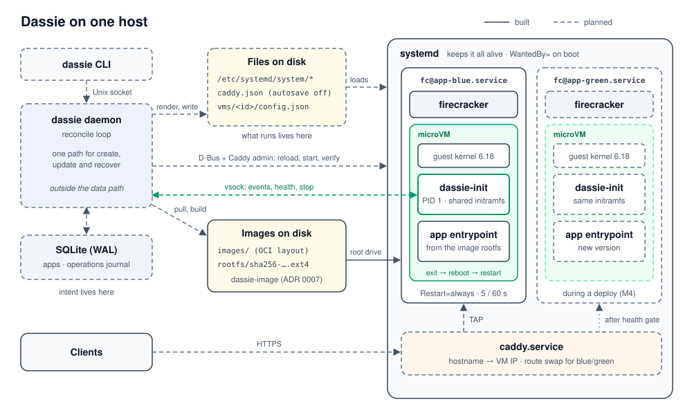

# dassie

A small, personal micro-VM app host for a single Linux machine. A daemon turns
desired state into plain systemd units: one Caddy unit plus a unit per
Firecracker microVM, each VM running a single container. An app can have
several VMs at once, such as blue and green during a deploy or replicas for
high availability. systemd, not the daemon,
keeps everything alive, so a reboot or daemon crash returns to the same steady
state. The daemon exists for high availability and blue/green deploys via Caddy
route changes.

Status: M1 in progress. `dassie-init` boots as PID 1 in a Firecracker microVM
under a hand-written systemd unit, and `dassie-image` pulls an OCI image and
builds its rootfs from it. VMs get a routed TAP each, isolated from one
another by one nft table (ADR 0008). There is no daemon yet.

## Crates

| Crate | Role |
| --- | --- |
| [`dassie`](crates/dassie) | Host daemon and CLI: reconcile loop, SQLite, systemd, Caddy |
| [`dassie-vm`](crates/dassie-vm) | Firecracker and jailer config, Firecracker API socket |
| [`dassie-image`](crates/dassie-image) | OCI image to ext4 guest rootfs |
| [`dassie-proto`](crates/dassie-proto) | Host <-> guest protocol over vsock |
| [`dassie-init`](crates/dassie-init) | Guest PID 1 (static musl) |

Design decisions are recorded in [architecture/](architecture/), which also
has diagrams of a VM's lifecycle and the vsock channels.



## Guest assets

[`guest/`](guest/) holds the scripts that build the guest kernel, the shared
initramfs and a test app rootfs, plus the hand-written
[`fc@.service`](guest/systemd/fc@.service), the networking units, and their
[runbook](guest/systemd/README.md) (ADR 0006, ADR 0008). They run on Linux:

```sh
guest/kernel/build.sh x86_64   # target/guest/x86_64/vmlinux
guest/initramfs.sh x86_64      # target/guest/x86_64/initramfs.cpio.gz
guest/rootfs.sh x86_64         # target/guest/x86_64/rootfs.ext4
guest/firecracker.sh x86_64    # target/guest/x86_64/firecracker
guest/smoke-test.sh x86_64     # boot once, expect started, ready, exited
```

To build a rootfs from a real OCI image instead (ADR 0007), pull the image
into a local OCI layout and build it. The pull fetches only the blobs the
store lacks and prints the manifest digest to pin. The build needs
`mkfs.ext4` from e2fsprogs 1.47.1 or later and the libarchive shared library
(Debian: `libarchive13t64`):

```sh
cargo run -p dassie-image --example image -- pull \
  --store $HOME/images docker.io/nginxinc/nginx-unprivileged:alpine   # prints sha256:…
cargo run -p dassie-image --example image -- build \
  --store $HOME/images --out $HOME/rootfs sha256:…   # prints the .ext4 path
```

`skopeo copy docker://… oci:$HOME/images:<name>` writes the same layout, for
offline import. The artefact is read-only and named by manifest digest. A
re-pull fetches no blobs, and a rebuild of the same image is a no-op.
`cargo test -p dassie-image -- --ignored` checks a real build on Linux.

## Development

macOS is the development machine; dassie targets Linux only
(`x86_64-unknown-linux-musl` primary, `aarch64-unknown-linux-musl` secondary).
The toolchain and targets are pinned in `rust-toolchain.toml`.

```sh
cargo build --workspace
cargo test --workspace
cargo fmt --all --check
cargo lint-x86    # clippy for x86_64-unknown-linux-musl, -D warnings
cargo lint-arm    # clippy for aarch64-unknown-linux-musl, -D warnings
RUSTDOCFLAGS="-D warnings" cargo doc --workspace --no-deps
cargo deny check  # advisories, licenses, bans, sources (deny.toml)
cargo shear       # unused dev-dependencies (cargo's own lint covers the rest)
```

Install the extra tools with `cargo install --locked cargo-deny cargo-shear`.
`cargo lint-x86` and `cargo lint-arm` are aliases in `.cargo/config.toml`.
They lint the Linux-only code from macOS: clippy only type-checks, so no Linux
linker is needed. A plain `cargo clippy` on macOS skips everything behind
`cfg(target_os = "linux")`.

Lint policy lives in `[workspace.lints]` in `Cargo.toml`; warnings fail CI.
Cargo's own lints (`[workspace.lints.cargo]`) deny unused dependencies and
unused workspace dependencies during any build or clippy run.
`unsafe` is denied by default: a crate that needs it opts in with
`#![allow(unsafe_code)]` at its root, and every `unsafe` block needs a
`// SAFETY:` comment. `dassie-init` (PID 1) and `dassie-proto` (parses
untrusted guest input) also deny `unwrap`, `expect`, `panic!` and indexing at
their crate roots.

CI also runs [actionlint](https://github.com/rhysd/actionlint) and
[zizmor](https://docs.zizmor.sh) on `.github/`, `shellcheck` on `guest/`,
the `guest/net-env-test.sh` known-answer test for VM addressing, and a
`kvm-boot` job that runs the guest smoke test on an x86_64 KVM runner.

Workflows reference actions by release tag; `.github/workflows/actions.lock`
pins each tag, and every transitive action, to a verified commit. After
changing any `uses:`, run `gh actions-lock` (from
[gh-actions-lock](https://github.com/github/gh-actions-lock)) and commit the
lockfile; CI runs `gh actions-lock --verify`. Dependabot updates both.

Crate updates get the same 7-day cooldown as Dependabot:
`registry.global-min-publish-age` in `.cargo/config.toml` makes the resolver
(`cargo update`, new dependencies) skip versions published in the last week,
unless already in `Cargo.lock`. The comment there shows how to take an urgent fix sooner.

### Fuzzing

`fuzz/` holds [cargo-fuzz](https://github.com/rust-fuzz/cargo-fuzz) targets
for `dassie-proto` and the `dassie-image` flattener. It is a workspace of its own, so the stable checks above
never build it. It needs nightly (`rustup toolchain install nightly`) and
`cargo install --locked cargo-fuzz`.

```sh
cargo +nightly fuzz run recv fuzz/corpus/recv fuzz/seeds/recv -- \
  -create_missing_dirs=1 -max_total_time=60 -max_len=131072 -dict=fuzz/proto.dict
cargo +nightly fuzz run roundtrip -- -max_total_time=60 -max_len=131072
cargo +nightly fuzz run flatten_model -- -max_total_time=60 -max_len=131072
cargo +nightly fuzz run flatten_bytes fuzz/corpus/flatten_bytes fuzz/seeds/flatten_bytes -- \
  -create_missing_dirs=1 -max_total_time=60 -max_len=131072 -dict=fuzz/tar.dict
```

- `recv` feeds arbitrary bytes to `FrameReader::recv` as `Event`, `Request`
  and `Response`. It checks that nothing panics, that only EOF and
  `LineTooLong` stop the stream, and that an accepted frame carries the `v`
  and `type` that `FrameWriter` sends for the decoded value, which must
  round-trip (ADR 0004). Unknown fields the reader ignores are not compared.
- `roundtrip` generates messages with the `arbitrary` feature of
  `dassie-proto`. It checks that every frame `FrameWriter::send` emits decodes
  back to the same value.
- `flatten_model` generates 1–4 layers of directories, files, symlinks, hard
  links, whiteouts and opaque markers over the names `a`, `b`, `c` and
  `.dassie`, up to three deep, so paths collide often. Only a dangling or
  replaced hard link may fail. Otherwise the output must hold every parent
  before its children, no path twice, hard links after their non-directory
  targets, no `..` or absolute paths, and `.dassie/image.json` last and
  alone under `.dassie`. The same input must give the same bytes, and the
  same entries as a naive reference model of the OCI layer rules (ADR 0007):
  each layer's whiteouts hide only lower layers, then its entries apply in
  tar order.
- `flatten_bytes` feeds arbitrary bytes to the flattener as one layer. It may
  reject them, but must not panic, and anything it accepts must meet the
  same output invariants.

`-max_len` is above `MAX_LINE`, so oversized frames are reachable. Seeds from
ADR 0004 and small layer tars live in `fuzz/seeds/` and are committed. New inputs go to
`fuzz/corpus/`, which is ignored. Crashes are saved to `fuzz/artifacts/<target>/`.
Replay one with `cargo +nightly fuzz run <target> <file>`. CI runs each target
for 60 s on a pinned nightly and uploads crash inputs as an artifact.

Tests that need KVM, Firecracker, systemd or TAP devices run on an x86_64 Linux
GitHub Actions runner or in a local aarch64 Linux VM (Apple Silicon M3 or later
with macOS 15 or later for nested virtualisation).

## License

[MIT](LICENSE)
