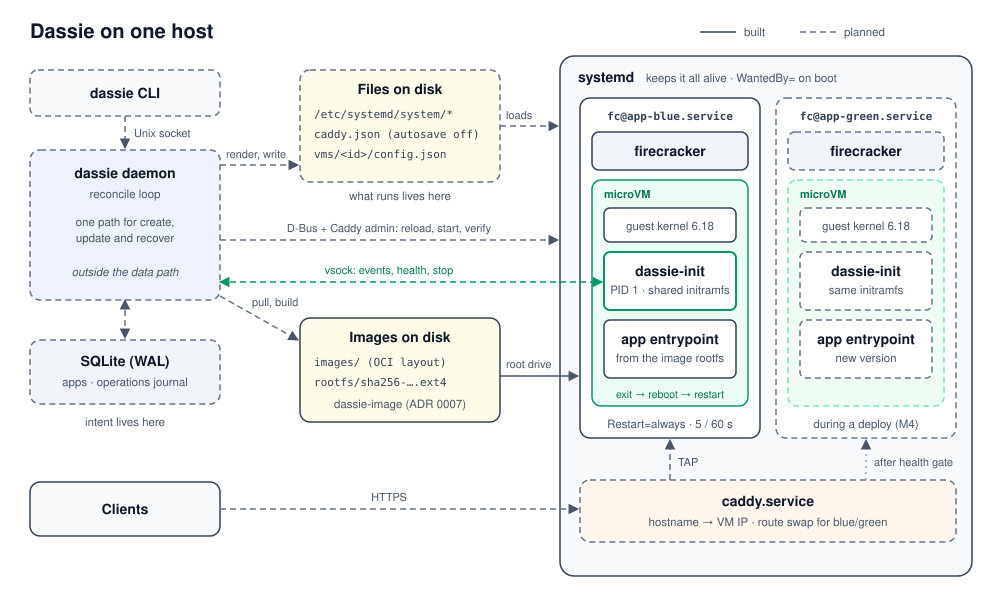
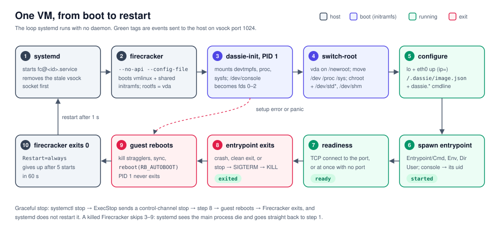
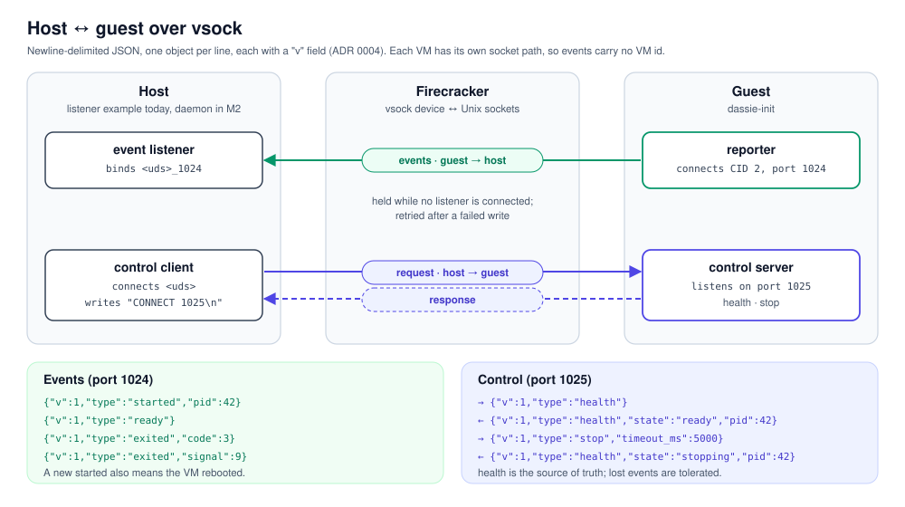

# Architecture Decision Records

Short records of architectural decisions, one per file. An ADR is added in the
same change that makes the decision. Start new ones from
[the template](../.claude/skills/adr/template.md); the conventions are in
[the adr skill](../.claude/skills/adr/SKILL.md).

| # | Title | Status |
| --- | --- | --- |
| [0001](0001-record-architecture-decisions.md) | Record architecture decisions | Accepted |
| [0002](0002-cargo-workspace-crate-layout.md) | Cargo workspace crate layout | Accepted |
| [0003](0003-linux-only-targets.md) | Linux-only targets | Accepted |
| [0004](0004-host-guest-wire-protocol.md) | Host <-> guest wire protocol | Accepted |
| [0005](0005-guest-init-contract.md) | Guest init contract | Accepted |
| [0006](0006-guest-assets-layout.md) | Guest assets and the initramfs switch-root | Accepted |
| [0007](0007-image-store-and-rootfs-build.md) | Image store and rootfs build | Accepted |

## Diagrams

Hand-written SVGs in [diagrams/](diagrams/). Update them in the same change as
the ADR or code they describe. Solid lines are built; dashed lines are planned.

**The host.** The daemon writes files and drives systemd and Caddy, but stays
outside the data path (ADR 0002).

**One VM, from boot to restart.** The loop systemd runs with no daemon
(ADR 0005, ADR 0006).

**Host ↔ guest over vsock.** Events on port 1024, control on port 1025
(ADR 0004).

