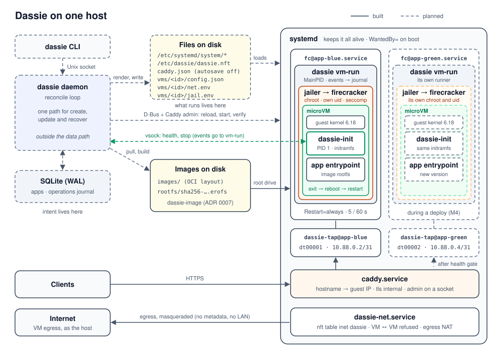
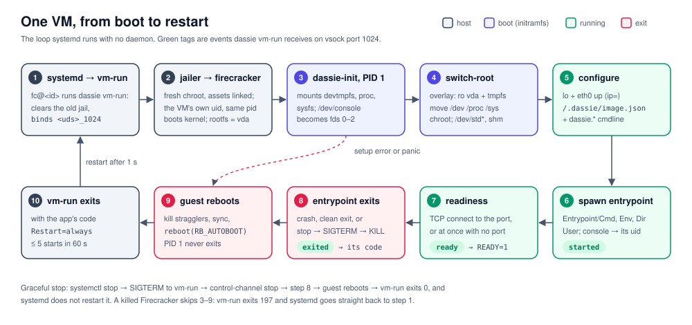
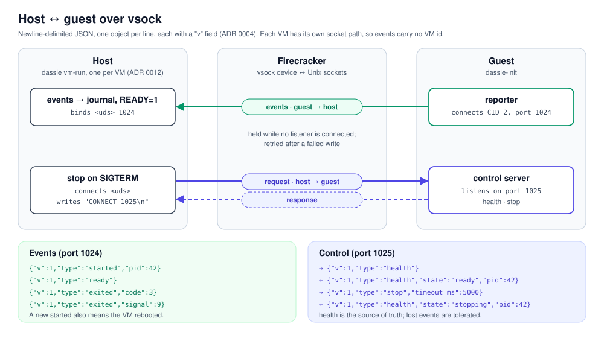
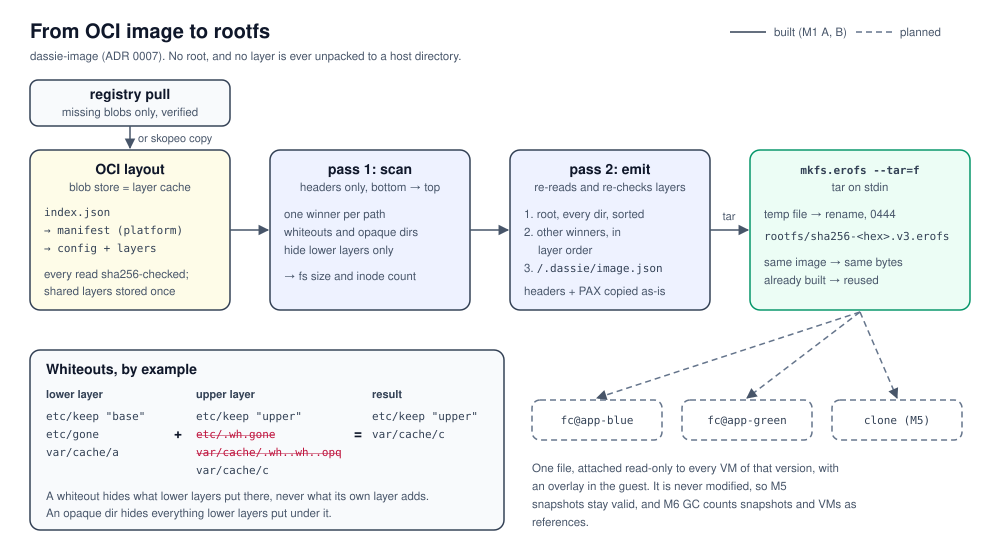
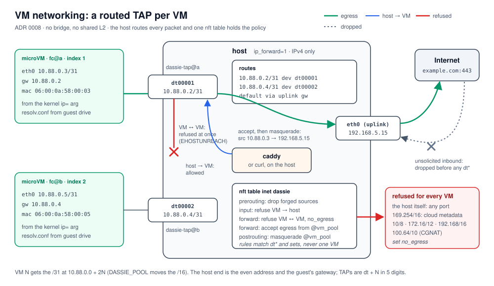
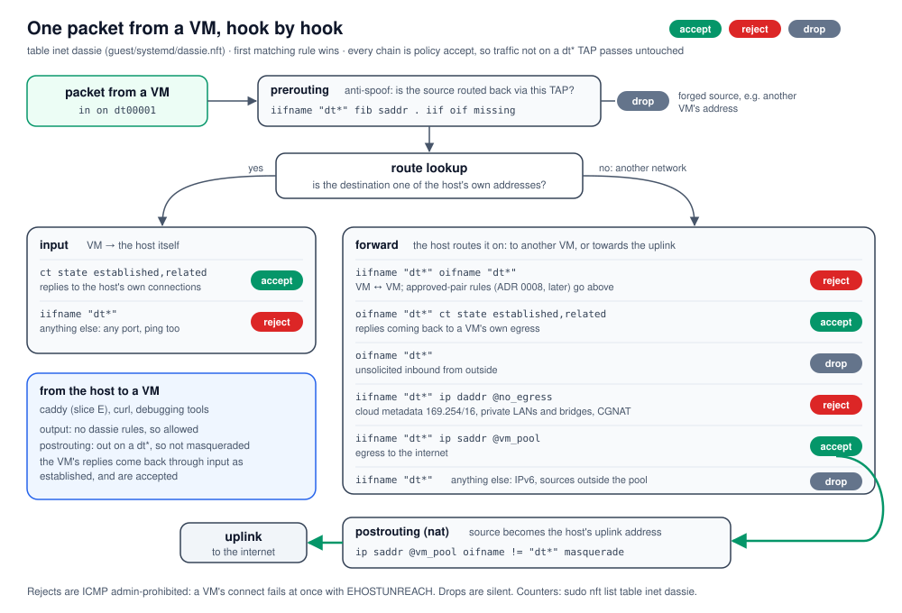

# Architecture Decision Records

Short records of architectural decisions, one per file. An ADR is added in the
same change that makes the decision. Start new ones from
[the template](../.claude/skills/adr/template.md); the conventions are in
[the adr skill](../.claude/skills/adr/SKILL.md).

| # | Title | Status |
| --- | --- | --- |
| [0001](0001-record-architecture-decisions.md) | Record architecture decisions | Accepted |
| [0002](0002-cargo-workspace-crate-layout.md) | Cargo workspace crate layout | Accepted |
| [0003](0003-linux-only-targets.md) | Linux-only targets | Accepted |
| [0004](0004-host-guest-wire-protocol.md) | Host <-> guest wire protocol | Accepted (`exited` delivery superseded by 0018) |
| [0005](0005-guest-init-contract.md) | Guest init contract | Accepted (cmdline config delivery superseded by 0015) |
| [0006](0006-guest-assets-layout.md) | Guest assets and the initramfs switch-root | Accepted (host unit superseded by 0012 and 0013, per-VM boot args by 0015) |
| [0007](0007-image-store-and-rootfs-build.md) | Image store and rootfs build | Accepted (rootfs format superseded by 0009, retries by 0011, copied headers by 0017) |
| [0008](0008-guest-networking.md) | Guest networking | Accepted (DNS delivery superseded by 0015) |
| [0009](0009-read-only-rootfs-format-erofs.md) | Read-only rootfs format: erofs | Accepted |
| [0010](0010-ingress-through-caddy.md) | Ingress through Caddy | Accepted |
| [0011](0011-registry-pull-retries.md) | Registry pull retries | Accepted |
| [0012](0012-per-vm-runner.md) | Per-VM runner | Accepted |
| [0013](0013-jailed-firecracker.md) | Firecracker runs in the jailer | Accepted |
| [0014](0014-apps-releases-instances.md) | Apps, releases and instances | Proposed |
| [0015](0015-guest-config-drive.md) | Guest config drive | Accepted |
| [0016](0016-store-data-access-layer.md) | Store data access layer | Accepted |
| [0017](0017-flattener-writes-fresh-tar-headers.md) | The flattener writes fresh tar headers | Accepted |
| [0018](0018-host-closes-events-after-exited.md) | The host closes the events connection after `exited` | Accepted |

## Diagrams

Hand-written SVGs in [diagrams/](diagrams/). Update them in the same change as
the ADR or code they describe. Solid lines are built; dashed lines are planned.

**The host.** The daemon writes files and drives systemd and Caddy, but stays
outside the data path (ADR 0002). Each VM's unit runs `dassie vm-run`, which
runs Firecracker in its jailer (ADR 0012, ADR 0013). Caddy proxies HTTPS to
each VM's guest address (ADR 0010).

**One VM, from boot to restart.** The loop systemd runs with no daemon,
with `dassie vm-run` as each unit's main process and Firecracker in its
jailer (ADR 0005, ADR 0006, ADR 0012, ADR 0013).

**Host ↔ guest over vsock.** Events on port 1024, control on port 1025
(ADR 0004). `dassie vm-run` is the host end of both (ADR 0012).

**From OCI image to rootfs.** Two passes over the layers, then
`mkfs.erofs --tar=f`: one read-only, digest-named file per image (ADR 0007,
ADR 0009).

**VM networking.** A routed TAP and a /31 per VM, with no bridge. The host
routes every packet, and one nft table refuses VM ↔ VM and VM → host and
masquerades egress (ADR 0008).

**One packet from a VM.** The `inet dassie` rules a packet meets, hook by
hook, and the verdict of each (ADR 0008).

